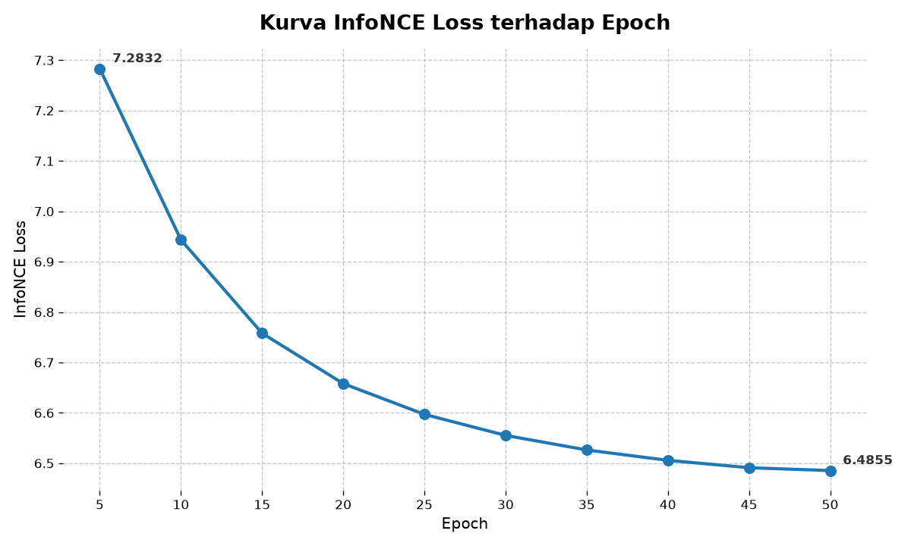

# Lampiran 3 — Self-Supervised Pre-Training MoCoV2

Direktori ini memuat kode program pelatihan mandiri (*self-supervised pre-training*) menggunakan kerangka kerja **Momentum Contrast V2 (MoCoV2)** dan fungsi objektif **InfoNCE Loss** pada *backbone* **ConvNeXt V2-Tiny** terhadap **402.205 *patch* WSI TCGA** tanpa label (Subbab 3.4 dan Subbab 4.4).

## Daftar Berkas
1. [`pretrain_mocov2.py`](./pretrain_mocov2.py) — Skrip utama *self-supervised pre-training* yang mencakup augmentasi dua cabang (`TwoViewTransform` berbasis `RandStainNA`), arsitektur `MoCoV2_ConvNeXt` (*query encoder*, *momentum encoder* EMA, *projection head* MLP, dan *FIFO dictionary queue* $K=65.536$), serta siklus optimisasi selama 50 *epoch*.
2. [`inspect_checkpoints.py`](./inspect_checkpoints.py) — Skrip audit *checkpoint* untuk mengekstrak progres *InfoNCE Loss*, *learning rate*, jarak Euclidean (L2) antara *query encoder* dan *momentum encoder*, serta *Effective Rank* (SVD) dari *dictionary queue*.
3. [`raw_checkpoint_audit_summary.csv`](./raw_checkpoint_audit_summary.csv) — Tabel keluaran hasil audit pada 10 interval *checkpoint* (*epoch* 5 hingga *epoch* 50).
4. [`plot_infonce_curve.py`](./plot_infonce_curve.py) — Skrip visualisasi kurva konvergensi *InfoNCE Loss* terhadap *epoch* yang membaca data langsung dari `raw_checkpoint_audit_summary.csv`.
5. [`Gambar_Kurva_InfoNCE_Loss.png`](./Gambar_4_8_Kurva_InfoNCE_Loss.png) — Visualisasi grafik penurunan *InfoNCE Loss* dari *epoch* ke-5 hingga *epoch* ke-50 (Gambar 4.8 pada naskah skripsi).

## Ringkasan Progres InfoNCE Loss dan Learning Rate (Tabel 4.11)
| Epoch | Global Step | Learning Rate | InfoNCE Loss | Selisih Penurunan | Queue Effective Rank (SVD) |
| :---: | :---: | :---: | :---: | :---: | :---: |
| **5** | 62.815 | $2,00 \times 10^{-4}$ | 7,2832 | - | 40,57 / 128 |
| **10** | 125.632 | $1,90 \times 10^{-4}$ | 6,9434 | 0,3398 | 64,88 / 128 |
| **15** | 188.448 | $1,71 \times 10^{-4}$ | 6,7580 | 0,1854 | 82,47 / 128 |
| **20** | 251.265 | $1,45 \times 10^{-4}$ | 6,6581 | 0,1000 | 95,50 / 128 |
| **25** | 314.081 | $1,15 \times 10^{-4}$ | 6,5970 | 0,0611 | 105,55 / 128 |
| **30** | 376.897 | $8,30 \times 10^{-5}$ | 6,5553 | 0,0417 | 112,38 / 128 |
| **35** | 439.714 | $5,39 \times 10^{-5}$ | 6,5264 | 0,0289 | 116,72 / 128 |
| **40** | 502.530 | $3,04 \times 10^{-5}$ | 6,5057 | 0,0206 | 119,39 / 128 |
| **45** | 565.344 | $1,53 \times 10^{-5}$ | 6,4911 | 0,0146 | 120,90 / 128 |
| **50** | 628.159 | $1,00 \times 10^{-5}$ | 6,4855 | 0,0056 | 121,76 / 128 |

## Visualisasi Kurva Konvergensi InfoNCE Loss (Gambar 4.8)

