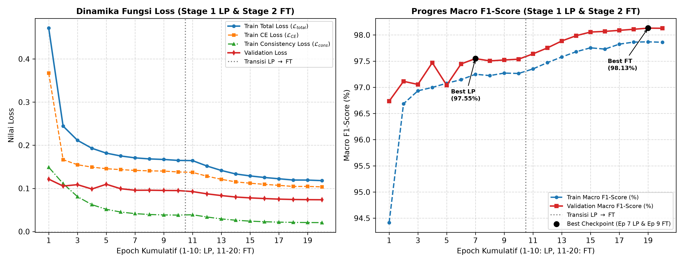

# Lampiran 4 — Pelatihan Model Klasifikasi (Siamese Network & Normalized Feature Consistency Loss)

Direktori ini memuat kode program pelatihan model klasifikasi tujuh kelas jaringan kanker kolorektal menggunakan arsitektur **ConvNeXt V2-Tiny** berinisialisasi bobot **SSL MoCoV2** (`convnext_v2_tiny_ssl.pth`), skema _shared-weights_ **Siamese Network**, augmentasi warna **RandStainNA**, serta regularisasi **Normalized Feature Consistency Loss** ($\mathcal{L}_{cons}$) dengan bobot optimal $\lambda = 0,7$ melalui tahapan _Linear Probing_ (Stage 1) dan _Full Fine-Tuning_ (Stage 2) pada dataset **NCT-CRC** .

## Daftar Berkas

1. [`train_classification_siamese.py`](./train_classification_siamese.py) — Skrip utama pelatihan dua tahap (_Automated Two-Stage LP-FT_) yang mengimplementasikan transformasi spasial sinkron (`torch.cat` dan `torch.split`), perhitungan _Dual Cross-Entropy Loss_ ($\mathcal{L}_{CE}$), dan _Normalized Feature Consistency Loss_ ($\mathcal{L}_{cons}$) berbasis _L2-normalization_ serta _cosine distance_.
2. [`stage1_lp_history.csv`](./stage1_lp_history.csv) — Log riwayat pelatihan dan validasi pada **Tahap 1: Linear Probing** selama 10 _epoch_ .
3. [`stage2_ft_history.csv`](./stage2_ft_history.csv) — Log riwayat pelatihan dan validasi pada **Tahap 2: Full Fine-Tuning** selama 10 _epoch_ .
4. [`plot_training_curves.py`](./plot_training_curves.py) — Skrip visualisasi kurva dinamika fungsi _loss_ ($\mathcal{L}_{total}, \mathcal{L}_{CE}, \mathcal{L}_{cons}$) dan progres _Macro F1-Score_ lintas tahap.

## Ringkasan Konfigurasi Pelatihan 

| Parameter                             |            Tahap 1: Linear Probing (LP)             |           Tahap 2: Full Fine-Tuning (FT)            |
| :------------------------------------ | :-------------------------------------------------: | :-------------------------------------------------: |
| **Inisialisasi Bobot**                |             `convnext_v2_tiny_ssl.pth`              |            `best_model.pth` (Epoch 7 LP)            |
| **Status Parameter Backbone**         |         _Frozen_ (`requires_grad = False`)          |         _Unfrozen_ (`requires_grad = True`)         |
| **Optimizer & Weight Decay**          |            AdamW (`weight_decay = 0,05`)            |            AdamW (`weight_decay = 0,05`)            |
| **Base Learning Rate**                |                $5,00 \times 10^{-4}$                |                $1,00 \times 10^{-6}$                |
| **Min Learning Rate**                 |                $1,00 \times 10^{-5}$                |                $1,00 \times 10^{-7}$                |
| **Layer-wise LR Decay**               |                         1,0                         |                         0,9                         |
| **Koefisien Konsistensi ($\lambda$)** |                         0,7                         |                         0,7                         |
| **Capaian Validasi Terbaik**          | **Epoch 7** (`Val F1 = 97,55%`, `Val Acc = 97,32%`) | **Epoch 9** (`Val F1 = 98,13%`, `Val Acc = 97,95%`) |

## Visualisasi Kurva Pelatihan Klasifikasi

